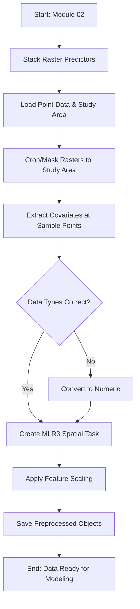
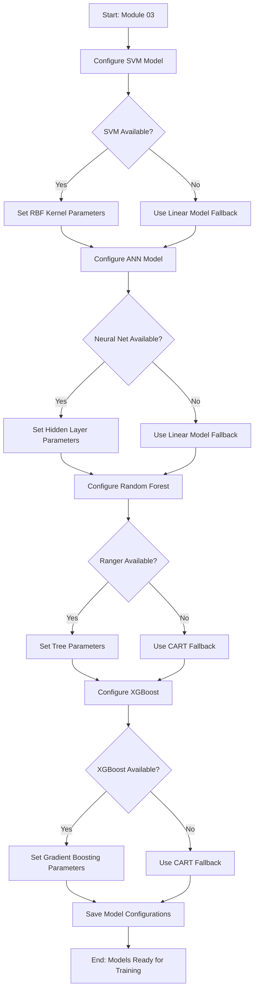
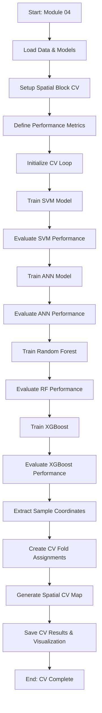
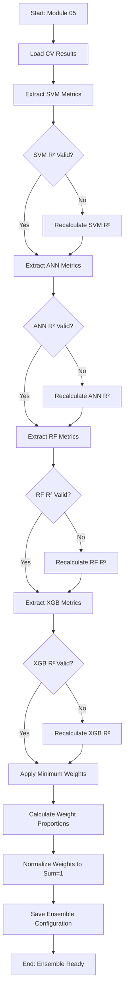
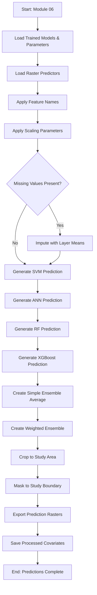
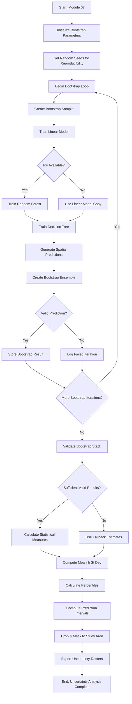
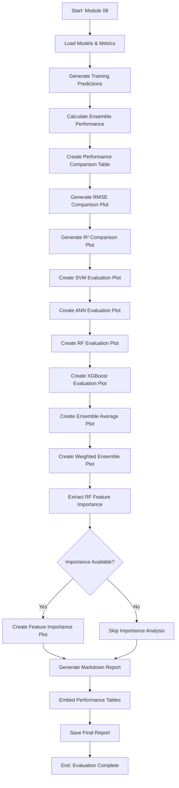
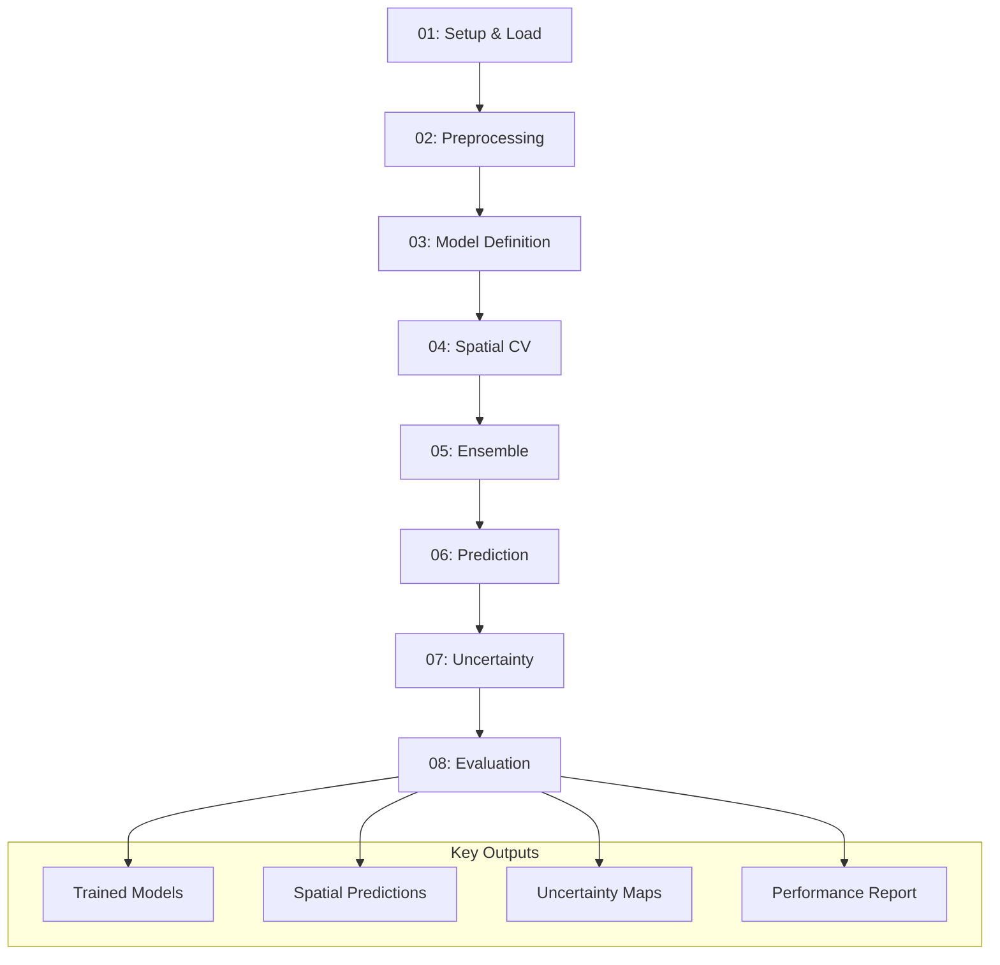

# Detailed Workflow Report: Soil Organic Carbon (SOC) Prediction Pipeline

## Project Overview

This project implements a comprehensive machine learning pipeline for predicting soil organic carbon (SOC) content in the Motupe region using spatial data and multiple ML algorithms. The workflow emphasizes spatial validation, ensemble methods, and uncertainty quantification for robust carbon stock estimation.

---

## Module 01: Setup and Load (`01_setup_and_load.R`)

### Purpose
Initialize the R environment, load required packages, install missing dependencies, and configure parallel processing for computational efficiency.

### Key R Packages
- **mlr3 ecosystem**: `mlr3`, `mlr3verse`, `mlr3spatiotempcv`, `mlr3viz`, `mlr3fselect`, `mlr3filters`, `mlr3tuning`, `mlr3learners`, `mlr3extralearners`
- **Machine Learning**: `keras`, `e1071`, `ranger`, `xgboost`, `nnet`
- **Geospatial**: `sf`, `terra`
- **Geostatistics**: `gstat`, `automap`
- **Data Manipulation**: `dplyr`, `tidyr`
- **Visualization**: `ggplot2`
- **Parallel Processing**: `foreach`, `doParallel`, `parallel`

### Process Flow
1. Load core packages for ML, spatial analysis, and visualization
2. Install missing packages automatically with error handling
3. Configure parallel processing cluster with optimal core usage (max 8 cores, leaving 1 for system)
4. Register parallel backend for downstream computational tasks

### Key Functions
- `library()`: Package loading
- `require()`: Conditional package loading with checks
- `install.packages()`: Automatic dependency installation
- `detectCores()`: System core detection
- `makeCluster()`: Parallel cluster creation
- `registerDoParallel()`: Parallel backend registration

### Results
- All required packages loaded and verified
- Parallel processing cluster established
- Environment ready for spatial ML pipeline

### Mermaid Flowchart

```mermaid
flowchart TD
    A[Start: Module 01] --> B[Load Core Packages]
    B --> C{All Packages Available?}
    C -->|No| D[Install Missing Packages]
    C -->|Yes| E[Setup Parallel Processing]
    D --> E
    E --> F[Detect System Cores]
    F --> G[Create Cluster: min(cores-1, 8)]
    G --> H[Register Parallel Backend]
    H --> I[Environment Ready]
    I --> J[End: Ready for Module 02]
```

---

## Module 02: Preprocessing (`02_preprocessing.R`)

### Purpose
Load and preprocess spatial data, extract covariates at sample locations, create ML tasks, and apply feature scaling for model compatibility.

### Key R Packages
- **Geospatial**: `terra`, `sf`
- **Data Manipulation**: `dplyr`
- **Machine Learning**: `mlr3`, `mlr3spatial`

### Process Flow
1. Stack raster predictors from the `/predictors` folder
2. Load point data (soil samples) and study area boundary
3. Crop and mask rasters to study area extent
4. Extract covariate values at sample locations
5. Create MLR3 spatial regression task
6. Apply feature scaling (standardization)
7. Save preprocessed objects for downstream modules

### Key Functions
- `terra::rast()`: Raster data loading and stacking
- `list.files()`: Dynamic file discovery
- `sf::read_sf()`: Vector data loading
- `terra::crop()`, `terra::mask()`: Spatial subsetting
- `terra::extract()`: Point-based covariate extraction
- `mlr3spatial::as_task_regr_st()`: Spatial task creation
- `po("scale")`: Feature scaling pipeline
- `saveRDS()`: Object serialization

### Data Transformation
- **Input**: Individual .tif raster files, .gpkg vector files
- **Processing**: Spatial alignment, value extraction, standardization
- **Output**: Scaled ML task, preprocessed covariates

### Feature Variables
- **Terrain**: Aspect, Hillshade, TPI (Topographic Position Index), TRI (Terrain Ruggedness Index), TWI (Topographic Wetness Index)
- **Soil Properties**: BD (Bulk Density), Clay, EC (Electrical Conductivity), pH, Silt
- **Remote Sensing**: EVI (Enhanced Vegetation Index), GNDVI (Green Normalized Difference Vegetation Index)
- **Climate**: Temperature

### Results
- `task_motupe_scaled.RDS`: Standardized ML task
- `po_scale.RDS`: Scaling parameters for prediction
- `covariates_with_xy.RDS`: Processed raster stack
- `covsoc_for_modeling.RDS`: Sample data with extracted features

### Mermaid Flowchart



---

## Module 03: Model Definition (`03_model_definition.R`)

### Purpose
Define and configure multiple machine learning algorithms with optimized hyperparameters and fallback mechanisms for missing packages.

### Key R Packages
- **MLR3**: `mlr3`, `mlr3learners`, `mlr3extralearners`
- **Algorithm-Specific**: `e1071` (SVM), `nnet` (ANN), `ranger` (RF), `xgboost` (XGBoost)

### Process Flow
1. Configure Support Vector Machine (SVM) with RBF kernel
2. Set up Artificial Neural Network (ANN) with single hidden layer
3. Define Random Forest with optimized parameters
4. Configure XGBoost with gradient boosting parameters
5. Implement error handling with linear model fallbacks
6. Save model configurations for training

### Model Configurations

#### SVM (Support Vector Machine)
- **Learner**: `regr.svm`
- **Kernel**: Radial Basis Function (RBF)
- **Parameters**: cost=10, gamma=0.1, epsilon=0.1
- **Fallback**: Linear regression if unavailable

#### ANN (Artificial Neural Network)
- **Learner**: `regr.nnet`
- **Architecture**: Single hidden layer with 10 neurons
- **Parameters**: maxit=500, decay=0.01, linout=TRUE
- **Activation**: Sigmoid (hidden), Linear (output)

#### Random Forest
- **Learner**: `regr.ranger`
- **Parameters**: 500 trees, mtry=sqrt(features), min.node.size=5
- **Feature Importance**: Impurity-based calculation enabled
- **Fallback**: CART decision tree if ranger unavailable

#### XGBoost
- **Learner**: `regr.xgboost`
- **Parameters**: 100 rounds, eta=0.1, max_depth=6
- **Regularization**: subsample=0.7, colsample_bytree=0.7
- **Importance**: Gain-based feature importance

### Key Functions
- `mlr3::lrn()`: Learner instantiation
- `tryCatch()`: Error handling and fallback implementation
- `saveRDS()`: Model configuration persistence

### Results
- `svm_model.RDS`: Configured SVM learner
- `ann_model.RDS`: Configured ANN learner
- `rf_model.RDS`: Configured Random Forest learner
- `xgb_model.RDS`: Configured XGBoost learner

### Mermaid Flowchart



---

## Module 04: Spatial Cross-Validation (`04_spatial_cv.R`)

### Purpose
Implement spatial block cross-validation to assess model performance while accounting for spatial autocorrelation, and visualize the CV partitioning scheme.

### Key R Packages
- **MLR3**: `mlr3`, `mlr3spatiotempcv`
- **Visualization**: `ggplot2`, `sf`

### Process Flow
1. Load preprocessed data and model configurations
2. Set up spatial block cross-validation (5-fold, 3x3 grid)
3. Define performance metrics (RMSE, MAE, R²)
4. Implement custom CV function with error handling
5. Execute spatial CV for each model independently
6. Create spatial partitioning visualization
7. Save CV results and performance metrics

### Spatial Cross-Validation Design
- **Method**: Spatial block CV (`spcv_block`)
- **Folds**: 5 spatial blocks
- **Grid**: 3x3 spatial grid for block creation
- **Rationale**: Accounts for spatial autocorrelation in soil data

### Performance Metrics
- **RMSE**: Root Mean Square Error (prediction accuracy)
- **MAE**: Mean Absolute Error (robust to outliers)  
- **R²**: Coefficient of determination (explained variance)

### Key Functions
- `mlr3::rsmp()`: Resampling strategy definition
- `run_single_model_cv()`: Custom CV implementation
- `learner$train()`: Model training on CV folds
- `learner$predict()`: Model prediction on test sets
- `pred$score()`: Performance metric calculation
- `ggplot()`: Spatial visualization
- `sf::st_coordinates()`: Coordinate extraction

### Visualization Output
- Spatial map showing CV fold assignments
- Study area boundary overlay
- Sample point locations colored by fold
- High-resolution PNG export (600 DPI)

### Results
- `svm_cv.RDS`: SVM CV results and trained model
- `ann_cv.RDS`: ANN CV results and trained model  
- `rf_cv.RDS`: Random Forest CV results and trained model
- `xgb_cv.RDS`: XGBoost CV results and trained model
- `spatial_cv_partitioning_map.png`: CV fold visualization

### Mermaid Flowchart



---

## Module 05: Ensemble (`05_ensemble.R`)

### Purpose
Calculate ensemble weights based on spatial cross-validation performance and prepare weighted ensemble predictions.

### Key R Packages
- **Base R**: Core statistical functions

### Process Flow
1. Load CV results from all models
2. Extract performance metrics with error handling
3. Calculate R² values for models with missing metrics
4. Compute performance-based ensemble weights
5. Normalize weights to sum to 1.0
6. Save ensemble configuration

### Weight Calculation Method
- **Basis**: R² values from spatial cross-validation
- **Minimum Weight**: 0.1 (prevents zero weights for poor models)
- **Formula**: weight_i = R²_i / Σ(R²_j) for all models j
- **Rationale**: Better-performing models get higher influence

### Key Functions
- `extract_metrics()`: Performance metric extraction with error handling
- `task$data()`: Task data access
- `model$predict()`: Model prediction for missing R² calculation
- Weight normalization arithmetic

### Fallback Mechanisms
- **Missing R²**: Recalculate using model predictions on full dataset
- **Invalid Metrics**: Set minimum weight of 0.1
- **Error Handling**: Graceful degradation with warning messages

### Results
- `ensemble_weights.RDS`: Normalized model weights
- Individual metric files: `svm_metrics.RDS`, `ann_metrics.RDS`, etc.
- Console output showing weight distribution

### Mermaid Flowchart



---

## Module 06: Prediction (`06_prediction.R`)

### Purpose
Generate spatial predictions across the study area using trained models and create ensemble predictions with proper uncertainty propagation.

### Key R Packages
- **Geospatial**: `terra`, `sf`
- **Base R**: Arithmetic operations

### Process Flow
1. Load trained models and preprocessing parameters
2. Prepare raster covariates with proper scaling
3. Handle missing values through imputation
4. Generate individual model predictions
5. Create ensemble predictions (average and weighted)
6. Crop and mask results to study area
7. Export prediction rasters

### Raster Processing Pipeline
1. **Loading**: Read stacked predictor rasters
2. **Naming**: Apply consistent feature names
3. **Scaling**: Apply same standardization as training data
4. **Imputation**: Fill NA values with layer means
5. **Prediction**: Apply trained models to scaled rasters

### Prediction Methods
- **Individual Models**: Direct application of trained learners
- **Simple Ensemble**: Arithmetic mean of all predictions
- **Weighted Ensemble**: Performance-weighted combination

### Key Functions
- `terra::predict()`: Raster-based model prediction
- `scale_raster()`: Custom scaling function using saved parameters
- `impute_raster_na()`: Missing value imputation
- `terra::crop()`, `terra::mask()`: Spatial clipping
- `terra::writeRaster()`: Raster export

### Scaling Implementation
- Uses parameters from Module 02 preprocessing
- Applies: (value - center) / scale for each band
- Ensures consistency between training and prediction data

### Results
- `svm_prediction_spatial_cv.tif`: SVM spatial predictions
- `ann_prediction_spatial_cv.tif`: ANN spatial predictions  
- `rf_prediction_spatial_cv.tif`: Random Forest spatial predictions
- `xgb_prediction_spatial_cv.tif`: XGBoost spatial predictions
- `ensemble_avg_spatial_cv.tif`: Simple ensemble average
- `ensemble_weighted_spatial_cv.tif`: Performance-weighted ensemble
- `all_covariates_scaled_imputed.RDS`: Processed prediction rasters

### Mermaid Flowchart



---

## Module 07: Uncertainty (`07_uncertainty.R`)

### Purpose
Quantify prediction uncertainty using bootstrap ensemble methods and generate comprehensive uncertainty maps including confidence intervals and prediction intervals.

### Key R Packages
- **Geospatial**: `terra`, `sf`
- **Machine Learning**: `mlr3`, `ranger`
- **Base R**: Statistical functions

### Process Flow
1. Initialize bootstrap parameters (10 iterations)
2. Create bootstrap samples from training data
3. Train diverse model ensemble for each bootstrap
4. Generate spatial predictions for each bootstrap iteration
5. Calculate uncertainty statistics across bootstrap predictions
6. Create comprehensive uncertainty maps
7. Export uncertainty raster stack

### Bootstrap Methodology
- **Iterations**: 10 bootstrap samples
- **Sampling**: Bootstrap resampling with replacement
- **Models per Bootstrap**: Linear, Random Forest, CART tree ensemble
- **Fallbacks**: Linear model when advanced methods fail

### Uncertainty Metrics
- **Mean**: Central tendency of bootstrap predictions
- **Standard Deviation**: Absolute uncertainty measure
- **Coefficient of Variation**: Relative uncertainty (%)
- **5th/95th Percentiles**: 90% prediction interval bounds
- **PI90 Width**: Prediction interval width
- **Relative PI90**: Prediction interval as % of mean

### Key Functions
- `bootstrap_ensemble_prediction()`: Custom bootstrap function
- `sample()`: Bootstrap resampling
- `terra::predict()`: Spatial prediction
- `mean()`, `stdev()`: Uncertainty statistics
- `quantile()`: Percentile calculations

### Error Handling
- Individual bootstrap iteration failures are caught and logged
- Minimum valid predictions required (5 out of 10)
- Fallback uncertainty estimates if bootstrap fails
- Spatial alignment checks between predictions

### Quality Control
- Validates prediction completeness (>10% non-NA values)
- Ensures spatial consistency across bootstrap iterations
- Filters invalid predictions before statistical calculations

### Results
- `bootstrap_mean_spatial_cv.tif`: Bootstrap ensemble mean
- `bootstrap_stdev_spatial_cv.tif`: Standard deviation map
- `bootstrap_cv_spatial_cv.tif`: Coefficient of variation
- `bootstrap_pi90_width_spatial_cv.tif`: Prediction interval width
- `bootstrap_pi90_relative_spatial_cv.tif`: Relative prediction interval
- `bootstrap_q05_spatial_cv.tif`: 5th percentile
- `bootstrap_q95_spatial_cv.tif`: 95th percentile
- `bootstrap_uncertainty_stack_spatial_cv.tif`: Combined uncertainty stack

### Mermaid Flowchart



---

## Module 08: Evaluation and Report (`08_evaluation_and_report.R`)

### Purpose
Generate comprehensive model evaluation, create performance visualizations, extract feature importance, and produce final analytical report.

### Key R Packages
- **Visualization**: `ggplot2`
- **Data Manipulation**: Base R, `dplyr` (implicit)
- **Machine Learning**: Access to trained models

### Process Flow
1. Load all trained models and metrics
2. Generate predictions on training data for ensemble evaluation
3. Calculate comprehensive performance statistics
4. Create model comparison visualizations
5. Generate observed vs. predicted scatter plots
6. Extract and visualize feature importance
7. Compile final markdown report

### Performance Analysis
- **Individual Models**: CV-based performance metrics
- **Ensemble Methods**: Training data evaluation
- **Comparison Table**: Side-by-side model performance
- **Statistical Measures**: RMSE, MAE, R² for all models

### Visualization Suite

#### Performance Comparisons
- **RMSE Comparison**: Bar chart with model ranking
- **R² Comparison**: Performance visualization with color coding
- **Custom Styling**: Professional theme with model-specific colors

#### Observed vs. Predicted Plots
- **Individual Models**: Scatter plots with 1:1 reference line
- **Performance Annotations**: Embedded RMSE, MAE, R² statistics
- **Ensemble Comparisons**: Both average and weighted ensemble plots

#### Feature Importance Analysis
- **Random Forest**: Impurity-based importance extraction
- **Fallback Methods**: Multiple approaches for importance calculation
- **Visualization**: Horizontal bar chart with ranked features

### Key Functions
- `plot_observed_vs_predicted()`: Custom plotting function
- `get_rf_impurity_importance()`: Feature importance extraction
- `ggplot()`: Visualization framework
- `ggsave()`: High-resolution plot export
- `capture.output()`: Report generation

### Report Generation
- **Format**: Markdown with embedded results
- **Content**: Performance tables, methodology notes
- **Location**: `outputs/spatial_cv_report.md`

### Results
- **Performance Plots**: 
  - `spatial_cv_rmse_comparison.png`
  - `spatial_cv_r2_comparison.png`
- **Model Evaluation Plots**:
  - `svm_observed_vs_predicted.png`
  - `ann_observed_vs_predicted.png`  
  - `random_forest_observed_vs_predicted.png`
  - `xgboost_observed_vs_predicted.png`
  - `ensemble_average_observed_vs_predicted.png`
  - `ensemble_weighted_observed_vs_predicted.png`
- **Feature Analysis**: 
  - `rf_feature_importance_impurity.png`
- **Report**: `spatial_cv_report.md`

### Mermaid Flowchart



---

## Overall Pipeline Summary

### Complete Workflow Integration



### Methodological Strengths
1. **Spatial Awareness**: Spatial block CV prevents overoptimistic validation
2. **Robust Ensemble**: Multiple algorithms with performance weighting
3. **Comprehensive Uncertainty**: Bootstrap methods with multiple metrics
4. **Production Ready**: Error handling, fallbacks, and automated workflows
5. **Reproducible Science**: Systematic documentation and visualization

### Technical Innovation
- **Hybrid Approach**: Combines multiple ML paradigms (parametric, non-parametric, ensemble)
- **Spatial Validation**: Addresses fundamental challenges in spatial prediction
- **Uncertainty Quantification**: Multiple approaches for robust error estimation
- **Automated Pipeline**: End-to-end workflow with minimal manual intervention

This comprehensive pipeline represents state-of-the-art practices in spatial machine learning for environmental applications, specifically tailored for soil organic carbon mapping and assessment.