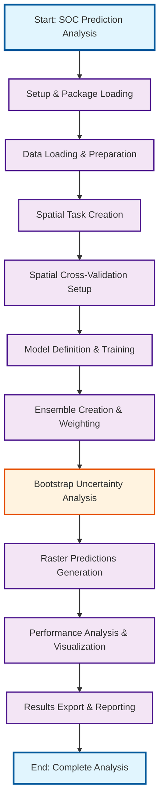
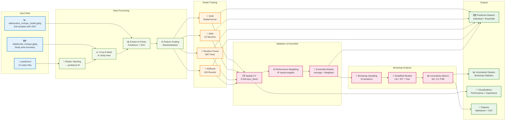
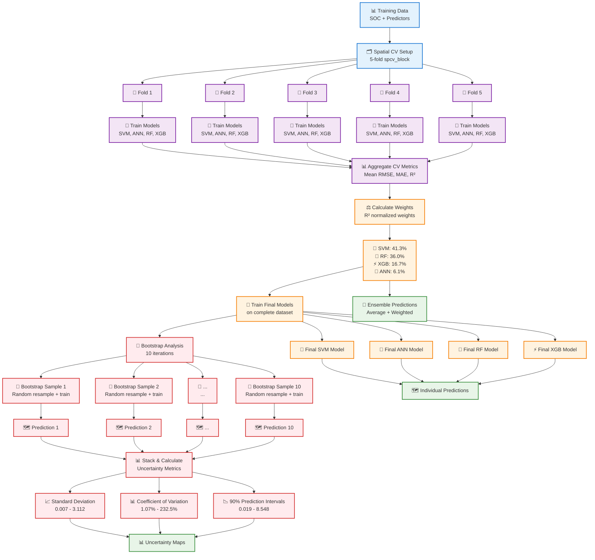
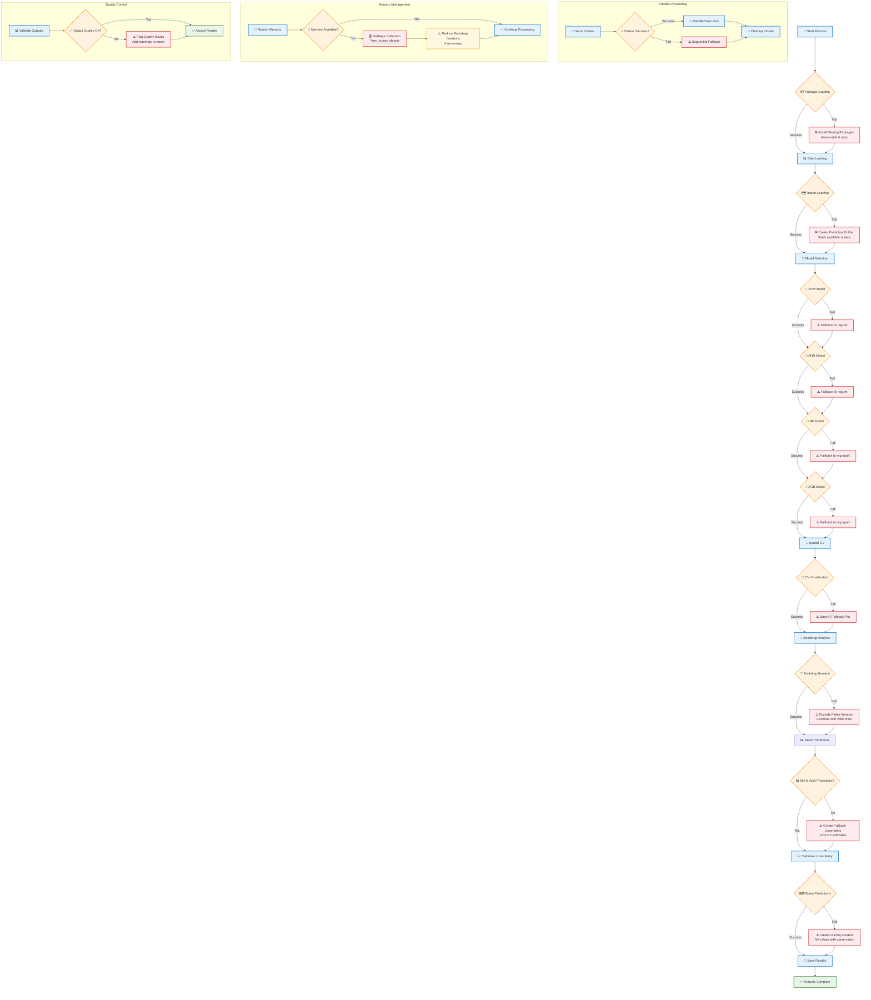
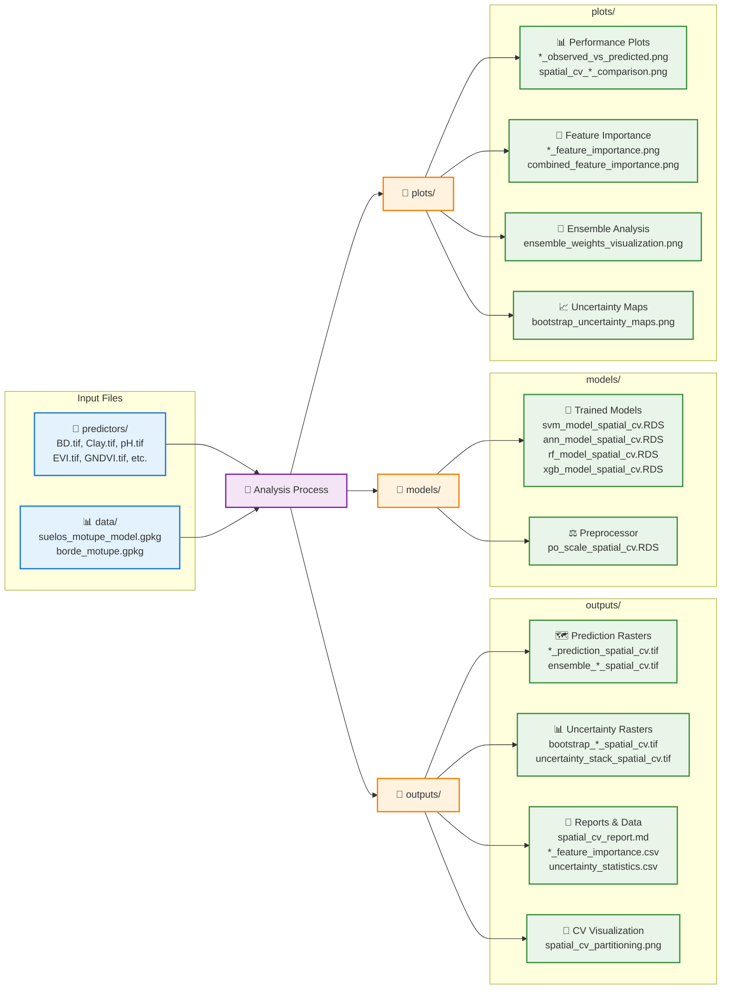

# SOC Prediction Workflow - Complete Process Flowchart
## Spatial Ensemble Machine Learning with Bootstrap Uncertainty Quantification

---

## Main Process Flow



---

## Detailed Process Flow

```mermaid
flowchart TD
    %% Setup Phase
    A[🚀 Start Analysis] --> B[📦 Load Required Packages<br/>mlr3, terra, sf, ggplot2, etc.]
    B --> B1[⚙️ Setup Parallel Processing<br/>detectCores - 1, max 8 cores]
    B1 --> C[📁 Load Input Data]

    %% Data Loading Phase
    C --> C1[🗺️ Stack Predictor Rasters<br/>from predictors/ folder]
    C1 --> C2[📊 Load Soil Data<br/>suelos_motupe_model.gpkg]
    C2 --> C3[🏞️ Load Study Area<br/>borde_motupe.gpkg]
    C3 --> C4[✂️ Crop & Mask Predictors<br/>to study area boundary]
    C4 --> C5[🔗 Extract Predictor Values<br/>at soil sample locations]

    %% Task Creation Phase
    C5 --> D[📋 Create Spatial ML Task<br/>mlr3spatial::as_task_regr_st]
    D --> D1[⚖️ Scale Features<br/>po_scale preprocessing]
    D1 --> E[🗂️ Spatial Cross-Validation<br/>spcv_block: 5 folds, 3x3 grid]

    %% Visualization
    E --> E1[🎨 Create CV Visualization<br/>ggplot2 + base R fallback]
    E1 --> F[🤖 Define ML Models]

    %% Model Definition Phase
    F --> F1[🧠 SVM Model<br/>regr.svm: radial kernel]
    F1 --> F2[🔗 ANN Model<br/>regr.nnet: 10 neurons]
    F2 --> F3[🌳 Random Forest<br/>regr.ranger: 500 trees]
    F3 --> F4[⚡ XGBoost<br/>regr.xgboost: 100 rounds]

    %% Spatial CV Phase
    F4 --> G[🔄 Spatial Cross-Validation<br/>Sequential model training]
    G --> G1[📊 SVM Spatial CV<br/>RMSE, MAE, R²]
    G --> G2[📊 ANN Spatial CV<br/>RMSE, MAE, R²]
    G --> G3[📊 RF Spatial CV<br/>RMSE, MAE, R²]
    G --> G4[📊 XGBoost Spatial CV<br/>RMSE, MAE, R²]

    %% Ensemble Phase
    G1 --> H[⚖️ Calculate Ensemble Weights]
    G2 --> H
    G3 --> H
    G4 --> H
    H --> H1[🎯 Performance-Based Weights<br/>R² normalized weights]
    H1 --> H2[🔄 Train Final Models<br/>on complete dataset]

    %% Feature Importance
    H2 --> I1[🎯 Extract Feature Importance<br/>RF: Gini impurity]
    I1 --> I2[🎯 Extract Feature Importance<br/>XGBoost: information gain]
    I2 --> I3[📊 Create Importance Plots<br/>Individual + combined]

    %% Bootstrap Analysis
    I3 --> J[🔄 Bootstrap Uncertainty Analysis<br/>10 iterations, sequential processing]
    J --> J1[🎲 Bootstrap Sampling<br/>Random resampling with replacement]
    J1 --> J2[🤖 Train Simplified Models<br/>LM, RF, Tree ensemble]
    J2 --> J3[🗺️ Generate Bootstrap Predictions<br/>Spatial raster predictions]
    J3 --> J4[✅ Spatial Validation<br/>Extent, CRS, NA checks]
    J4 --> J5[📊 Stack Valid Predictions<br/>Min 5 valid predictions required]
    J5 --> J6[📈 Calculate Uncertainty Metrics<br/>SD, CV, PI90, Quantiles]

    %% Raster Predictions
    J6 --> K[🗺️ Generate Final Predictions]
    K --> K1[🧠 SVM Raster Prediction]
    K --> K2[🔗 ANN Raster Prediction]
    K --> K3[🌳 RF Raster Prediction]  
    K --> K4[⚡ XGBoost Raster Prediction]
    K1 --> K5[⚖️ Ensemble Average<br/>(SVM+ANN+RF+XGB)/4]
    K2 --> K5
    K3 --> K5
    K4 --> K5
    K5 --> K6[🎯 Weighted Ensemble<br/>Performance-based weights]

    %% Performance Analysis
    K6 --> L[📊 Performance Analysis]
    L --> L1[📈 Observed vs Predicted<br/>Scatter plots for all models]
    L1 --> L2[📊 CV Metrics Comparison<br/>RMSE, MAE, R² visualization]
    L2 --> L3[🎯 Ensemble Weights Plot<br/>Weight distribution analysis]
    L3 --> L4[🔄 Uncertainty Visualization<br/>Bootstrap maps and statistics]

    %% Output Generation
    L4 --> M[💾 Export Results]
    M --> M1[🗺️ Save Prediction Rasters<br/>Individual + ensemble TIFs]
    M1 --> M2[📊 Save Uncertainty Rasters<br/>Bootstrap statistics TIFs]
    M2 --> M3[🎨 Save Visualizations<br/>Plots and maps PNG files]
    M3 --> M4[💾 Save Model Objects<br/>RDS files for reuse]
    M4 --> M5[📄 Generate Reports<br/>Markdown comprehensive report]

    %% Cleanup
    M5 --> N[🧹 Memory Cleanup]
    N --> N1[🗑️ Clear Bootstrap Objects<br/>Free memory]
    N1 --> N2[🔌 Stop Parallel Cluster<br/>Clean shutdown]
    N2 --> O[✅ Analysis Complete]

    %% Error Handling Branches
    F1 --> F1E[❌ SVM Fallback<br/>regr.lm if SVM fails]
    F2 --> F2E[❌ ANN Fallback<br/>regr.lm if nnet fails]
    F3 --> F3E[❌ RF Fallback<br/>regr.rpart if ranger fails]
    F4 --> F4E[❌ XGB Fallback<br/>regr.rpart if xgboost fails]
    
    J3 --> J3E[❌ Bootstrap Fallback<br/>Mean SOC if prediction fails]
    
    E1 --> E1E[❌ Viz Fallback<br/>Base R if ggplot2 fails]

    %% Styling
    classDef startEnd fill:#e1f5fe,stroke:#01579b,stroke-width:3px,color:#000
    classDef setup fill:#f3e5f5,stroke:#4a148c,stroke-width:2px,color:#000
    classDef data fill:#e8f5e8,stroke:#1b5e20,stroke-width:2px,color:#000
    classDef model fill:#fff3e0,stroke:#e65100,stroke-width:2px,color:#000
    classDef analysis fill:#ffebee,stroke:#c62828,stroke-width:2px,color:#000
    classDef output fill:#f1f8e9,stroke:#33691e,stroke-width:2px,color:#000
    classDef error fill:#fce4ec,stroke:#ad1457,stroke-width:1px,color:#000
    
    class A,O startEnd
    class B,B1,N,N1,N2 setup
    class C,C1,C2,C3,C4,C5,D,D1 data
    class E,E1,F,F1,F2,F3,F4,G,G1,G2,G3,G4,H,H1,H2 model
    class I1,I2,I3,J,J1,J2,J3,J4,J5,J6,K,K1,K2,K3,K4,K5,K6,L,L1,L2,L3,L4 analysis
    class M,M1,M2,M3,M4,M5 output
    class F1E,F2E,F3E,F4E,J3E,E1E error
```

---

## Data Flow Architecture



---

## Model Performance & Uncertainty Pipeline



---

## Error Handling & Fallback Strategy



---

## File Output Structure



This comprehensive flowchart documentation shows:
1. **Main Process Flow** - High-level overview
2. **Detailed Process Flow** - Step-by-step with error handling
3. **Data Flow Architecture** - How data moves through the system
4. **Model Performance Pipeline** - CV and uncertainty analysis
5. **Error Handling Strategy** - Fallback mechanisms
6. **File Output Structure** - What gets generated

The flowcharts can be rendered in any Markdown viewer that supports Mermaid diagrams (GitHub, GitLab, many IDEs, etc.).